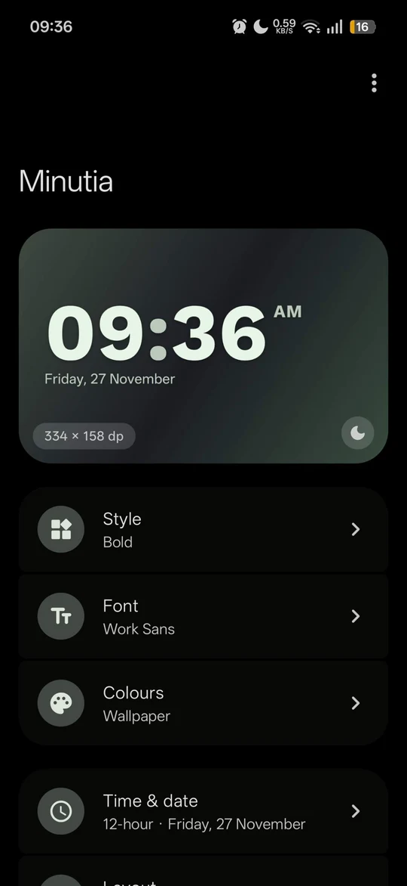

<h1 align="center">Minutia</h1>

<em>Sweat the small stuff.</em> A home-screen clock widget for Android where every detail is yours to tweak.

  

Bold · Pills · Words · Words, left-aligned in a thin Google Font. Colours come from the wallpaper.

 

<table align="center"><tr>
<td width="240"></td>
<td width="380">

**On the home screen**

Just the time, in the font and colours you choose. No box around it and no name underneath.

Tap it to open your clock app.

OnePlus 13s · OxygenOS 16

</td>
</tr></table>

<a href="../../releases/latest"><b>Download the latest APK</b></a>

## Features

**Widget**
- **5 styles**: Bold, Stacked, Pills, Analog, Words
- **Any Google Font**, typed in any capitalisation with suggestions as you type, or your own `.ttf`/`.otf`. Separate font for the date
- **Material You** colours from your wallpaper, or pick your own
- Size, weight, letter spacing, alignment, shadow, background, 12/24h, date presets or your own pattern (`EEE, d MMM` or `%a %d %b`)
- Tap to open your clock app (or any app you pick)
- No name under the widget by default; *Show name* adds a named one
- Updated every minute and redrawn the moment you wake the phone

**App**
- A live preview on top, settings grouped underneath, each opening its own page
- Theme (System / Light / Dark), pure black, and the app's own font
- A **Battery** row that spots OxygenOS restrictions and fixes them in one tap
- Updates from inside the app: a card on the home page when a new version is out; one tap downloads and installs it

## Install
Grab `Minutia-x.y.z.apk` from the [latest release](../../releases/latest), open it on your phone and allow "Install unknown apps" when asked. What changed in each version is in [CHANGELOG.md](CHANGELOG.md).
Then long-press your home screen → Widgets → Minutia.

On OnePlus/OxygenOS, if the app's **Battery** row says *Restricted*, tap **Fix** so the clock never lags.

## Part of a family

Four small Android apps built to look and behave like one set: same icon palette, Material 3 Expressive with your
wallpaper's colours, pure black mode, any Google Font for the app, the same settings layout, and in-app updates
from GitHub Releases.

| | |
|---|---|
| [**Aria**](https://github.com/savar95x/aria-player) | Music player for your local files |
| [**Minutia**](https://github.com/savar95x/minutia) | Clock widget where every detail is yours |
| [**Hiatus**](https://github.com/savar95x/hiatus) | How long you've been away from your phone |
| [**Regista**](https://github.com/savar95x/regista) | Reminders for the football matches you care about |

## Build
Every push to `main` builds a signed APK with GitHub Actions (`.github/workflows/build.yml`).
To release, bump `VERSION_NAME` in `version.properties` and add a matching section to `CHANGELOG.md`; CI then publishes `vX.Y.Z` on Releases.
Locally: `gradle :app:assembleRelease` with the Android SDK installed.

**Working on this with an AI agent?** Point it at [CLAUDE.md](CLAUDE.md) (also linked from `AGENTS.md` / `GEMINI.md`): build loop, architecture, conventions and gotchas. How-tos in [docs/RECIPES.md](docs/RECIPES.md), design history in [docs/DECISIONS.md](docs/DECISIONS.md).
