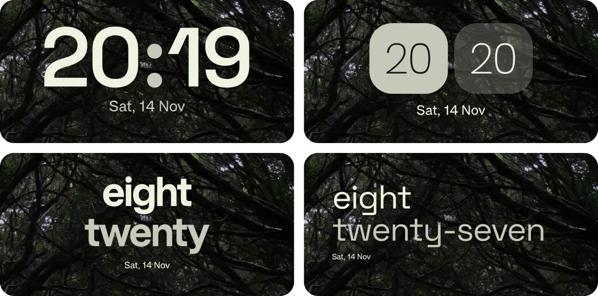
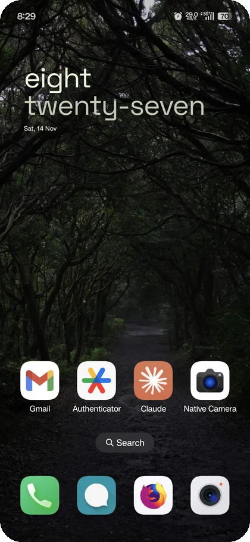

# Minutia

*Sweat the small stuff.* A home-screen clock widget for Android where every detail is yours to tweak.

  

Bold · Pills · Words · Words, left-aligned in a thin Google Font. Colours come from the wallpaper.

 

<table align="center"><tr>
<td width="240"></td>
<td width="380">

**On the home screen**

Just the time, in the font and colours you choose. No box around it and no name underneath.

Tap it to open your clock app.

OnePlus 13s · OxygenOS 16

</td>
</tr></table>

- **5 styles**: Bold, Stacked, Pills, Analog, Words
- **Any Google Font**: type a family name and it downloads on the phone; or load your own `.ttf`/`.otf`
- **Material You** colours from your wallpaper, or pick your own
- Size, weight, letter spacing, alignment, shadow, background card, date formats, 12/24h
- Per-widget settings with a live preview
- Tap to open your clock app (or any app you pick)
- Optional name under the widget: add the "named" variant from the widget picker, or flip *Show name under widget* in settings

## Install
Grab `Minutia-x.y.z.apk` from the [latest release](../../releases/latest), open it on your phone and allow "Install unknown apps" when asked. What changed in each version is in [CHANGELOG.md](CHANGELOG.md).
Then long-press your home screen → Widgets → Minutia.

On OnePlus/OxygenOS, open the app and tap **Allow background** so the clock never lags.

## Build
Every push to `main` builds a signed APK with GitHub Actions (`.github/workflows/build.yml`).
To release, bump `VERSION_NAME` in `version.properties` and add a matching section to `CHANGELOG.md`; CI then publishes `vX.Y.Z` on Releases.
Locally: `gradle :app:assembleRelease` with the Android SDK installed.
