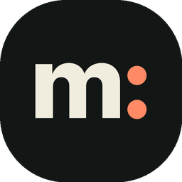

# Minutia app icon: design spec

<p align="center"></p>

## Concept
**"m:"**: the first letter of *Minutia* followed by a clock colon. It reads as the name and as a time
display at once (minute + minutiae: *sweat the small stuff*). Two shapes and two colours, nothing else.

## Typeface
- **Inter Display ExtraBold** (weight 800), lowercase `m` and `:`. Inter is licensed under the SIL OFL.
- Real glyph outlines are used as-is: no custom letterforms, no outline stroke (`EMBOLDEN = 0`).
- The colon uses Inter's **round** dots.

## Colour
| Role | Hex | Notes |
|---|---|---|
| Background | `#121614` | Deep ink with a hint of green. `@color/ic_launcher_bg` |
| Letter "m" | `#F0ECDE` | Warm cream, not pure white |
| Colon | `#FF8A65` | Coral accent, the only colour in the mark |

Themed icon (Android 13+): the monochrome layer is the same two shapes in one colour; the system tints it
to match the wallpaper.

## Geometry
The canvas is the standard **108 × 108 dp** adaptive-icon canvas. Launchers show roughly the central
72 dp and may mask it to any shape; the guaranteed-visible **safe zone** is a centred 66 dp circle.

| Measure | Value (dp, canvas coordinates) |
|---|---|
| Mark width ("m" through colon) | **44**, centred horizontally (x 32 → 76) |
| Mark height | ~22 (y 42.9 → 65.1), centred vertically on the glyphs' combined bounds |
| "m" bounds | x 32.0 → 65.5, y 42.9 → 64.7 |
| Colon bounds | x 68.4 → 76.0, y 44.1 → 65.1 |
| Gap between "m" and ":" | **0.07 em** (~2.9 dp) |
| Clearance to safe-zone edge | ~8 dp at the corners of the mark |

The mark is centred optically on its ink, not on font metrics, so it sits in the middle in every mask
(circle, squircle, rounded square, teardrop).

## Layers and files
| Layer | File |
|---|---|
| Background | `@color/ic_launcher_bg` in `app/src/main/res/values/colors.xml` |
| Foreground (full colour) | `app/src/main/res/drawable/ic_launcher_foreground.xml` |
| Monochrome (themed icons) | `app/src/main/res/drawable/ic_launcher_monochrome.xml` |
| Adaptive icon | `app/src/main/res/mipmap-anydpi-v26/ic_launcher.xml` |
| Preview for README | `docs/icon/icon.png` (256 px, squircle mask) |

The vector path data is **generated, never hand-edited**:
```bash
pip install fonttools brotli cairosvg pillow
python3 docs/icon/make.py --font /usr/share/fonts/opentype/inter/InterDisplay-ExtraBold.otf --write
```
Tweak the constants at the top of `make.py` (`WIDTH`, `GAP_EM`, `EMBOLDEN`, `BG`, `CREAM`, `CORAL`), regenerate,
and keep `BG` in sync with `@color/ic_launcher_bg`. The script also writes `icon_preview.png` (circle and
squircle masks, themed icon, 48 px) for checking at real launcher size.

## Rules
- Keep it to **two shapes, two colours** on the background. No gradients, shadows, outlines or extra marks.
- Check legibility at **48 px**: the counters inside the "m" must stay open.
- Don't use soft, bubbly or rounded-stroke letterforms; they read as the Meesho logo.
- Don't use square colon dots.
- If the weight changes, stay within Inter Display (SemiBold → Black); ExtraBold is the current choice.

## History
| Version | Design | Outcome |
|---|---|---|
| 1.0.0 | White clock ring with hands | Too generic |
| 1.8.0 | Custom rounded-stroke "m:" (picked from five concepts) | Felt like the Meesho logo |
| 1.8.1 | Fragment Mono "m" with square colon | Disliked, especially the square colon |
| 1.8.2 | Inter Display SemiBold "m:", Material You tonal sage/peach on green | Liked the "m", not the colours |
| **1.8.3** | **Inter Display ExtraBold "m:", cream + coral on ink** | **Current** |
